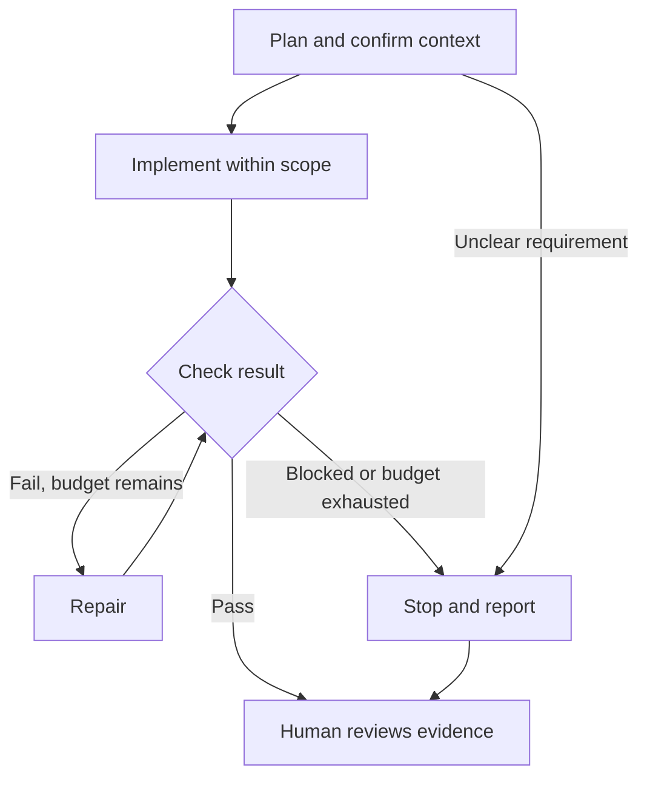

# A bounded Codex workflow

Use this supplied graph in the core task for session 3 and reuse it in sessions 4 and 5. A graph describes the available steps and branches; the loop is the repeated implement/check/repair route. No graph library or application agent is required.

Before execution, agree on the goal, relevant context, allowed changes, checks, and budget: at most two repair iterations or 20 minutes of agent execution, whichever comes first. The operator monitors elapsed time and stops execution at the limit; a prompt alone does not enforce a timer. Initial implementation is not a repair iteration.

Trace the branches actually visited in your evidence record and explain unvisited alternatives. If everything passes first time, label the other routes as hypothetical rather than inventing failures. A blocker means reporting what is missing and asking for the necessary human decision before dependent work resumes. Human review ends with accept, request changes, or defer; another run requires a new bounded instruction.

The graph controls development work with Codex. Application status New/Reviewed is a separate business workflow.
