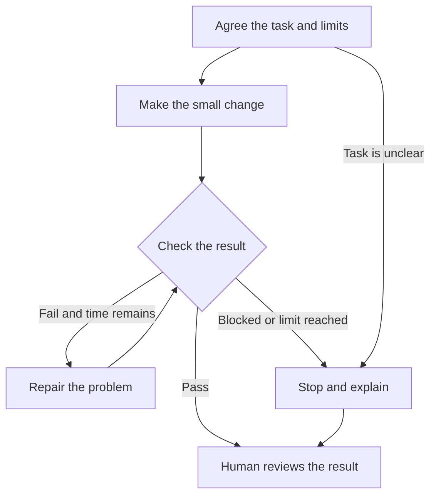

# A simple route for Codex's work

Use this in session 3. A **loop** repeats a check and repair. A **graph** shows the possible next steps. You are following this route while developing the app; you are not building a graph framework.

## Before you start

Agree the goal, useful files/examples, allowed changes, and checks. Allow at most **two repair attempts or 20 minutes of agent work**, whichever comes first. The initial implementation is not a repair attempt. You monitor the time; writing a limit in a prompt does not enforce a timer.

## While you work

- **Pass:** inspect the check results and changed lines. Decide whether to accept them.
- **Fail:** explain the failure, make a repair if budget remains, and check again.
- **Blocked:** explain what is missing and stop dependent work until a person resolves it.
- **Limit reached:** stop and report what works, what failed, and what remains.

Write down the route actually taken. If everything passes first time, explain what the other routes would mean without inventing a failure. Human review can end in accept, request changes, or defer. Another run needs a new agreed task and limit.

The app's New/Reviewed statuses describe the business request. They are separate from this route for developing code with Codex.
